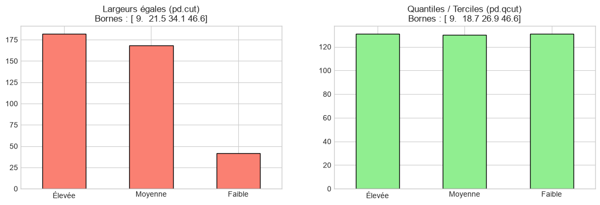
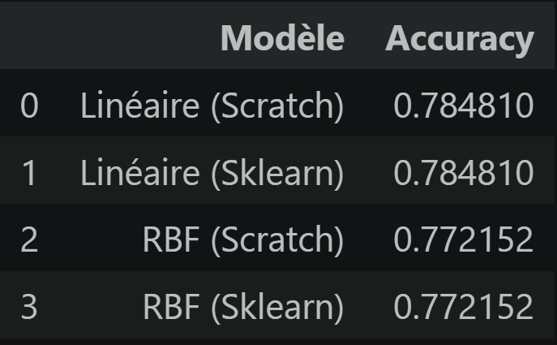
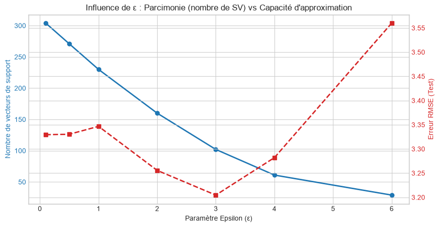

# Rapport Technique : Modélisation SVM de la Consommation Automobile (Auto MPG)
**Projet Individuel — Apprentissage Automatique Supervisé**  
**Filière :** Master MST-IDIA | Faculté des Sciences et Techniques de Tanger  
**Cadre académique :** Module Machine Learning (Pr. M. AIT KBIR)  
**Auteur :** Abajja Mohammed 

---

## Vue d'ensemble du Projet

Ce travail met en œuvre une chaîne de traitement complète pour prédire l'efficience énergétique de véhicules à partir du jeu de données *Auto MPG*. La problématique est abordée sous deux prismes d'apprentissage statistique :
1. **Classification ordinale (SVC) :** Segmentation de la consommation en trois régimes d'efficience à l'aide de classifieurs à marge maximale (linéaire et à noyau de Hilbert RBF).
2. **Régression parcimonieuse (SVR) :** Estimation continue de la métrique `mpg` par optimisation sous contrainte d'un tube de tolérance $\epsilon$-insensible.

L'ensemble des algorithmes a été conçu **ex nihilo (*from scratch*)** en résolvant directement la formulation duale du problème d'optimisation convexe, avant d'être confronté aux modules industriels de référence (`scikit-learn`).

---

## 1. Protocole de Prétraitement & Décisions Architecturales

Afin de garantir l'intégrité de l'apprentissage géométrique, un pipeline strict a été appliqué au dataset initial :

| Variable(s) | Traitement Appliqué | Justification Théorique & Algorithmique |
| :--- | :--- | :--- |
| `horsepower` (6 NaN) | **Suppression de lignes (`dropna`)** | Stabilise l'échantillon à exactement $N = 392$ observations sans introduire de variance artificielle par imputation approximative. |
| `name` | **Élimination** | Variable textuelle d'identification sans corrélation d'ordre avec la physique du véhicule. |
| `origin` | **Encodage One-Hot binaire** | Variable strictement qualitative nominale. Tout encodage entier ($1, 2, 3$) imposerait une distance euclidienne fausse ($d(\text{USA}, \text{Japon}) > d(\text{USA}, \text{Europe})$). |
| Tous les descripteurs | **Normalisation Z-Score** | Le calcul de la marge $\|W\|^{-1}$ et des distances radiales gaussiennes $\|X_i - X_j\|^2$ est biaisé si des variables d'ordres de grandeur divergents coexistent (`weight` $\sim 10^3$ vs `acceleration` $\sim 10^1$). |

> **Règle d'étanchéité :** Les paramètres de standardisation ($\mu, \sigma$) ont été calculés exclusivement sur l'ensemble d'entraînement ($80\%$) puis propagés sur l'ensemble de test ($20\%$) pour prévenir tout *data leakage*.

---

## 2. Analyse de la Discrétisation de la Cible (SVC)

### 2.1 Équilibre des Classes vs Distribution Réelle

La cible continue `mpg` a été convertie en 3 classes :
* **Classe 0 :** Consommation Élevée (faible distance par gallon)
* **Classe 1 :** Consommation Modérée
* **Classe 2 :** Consommation Faible (forte efficience kilométrique)

Deux politiques de partitionnement ont été confrontées :



1. **Partitionnement en intervalles constants (`pd.cut`) :**
   * Bornes obtenues : $[9.0, \; 21.5, \; 34.1, \; 46.6]$
   * Effectifs : **Classe 0 : 182** | **Classe 1 : 168** | **Classe 2 : 42**
   * *Diagnostic :* Fort déséquilibre provoqué par l'étalement de la distribution vers les fortes valeurs de MPG. La classe 2 est sous-représentée (10.7% des données), ce qui dégrade l'estimation de l'hyperplan séparateur pour les véhicules économiques.
2. **Partitionnement quantile par terciles (`pd.qcut`) — Solution retenue :**
   * Bornes obtenues : $[9.0, \; 18.7, \; 26.9, \; 46.6]$
   * Effectifs : **Classe 0 : 131** | **Classe 1 : 130** | **Classe 2 : 131**
   * *Diagnostic :* Équiprobabilité des classes a priori ($p \approx 0.333$). Cette stratégie élimine tout biais géométrique en faveur d'une classe dominante et stabilise l'optimisation des multiplicateurs de Lagrange.

---

## 3. Implémentation & Évaluation de la Classification (SVC)

### 3.1 Résolution Mathématique Duale

Plutôt que d'utiliser des approximations par descente de gradient, notre classe `SVMFromScratch` résout la formulation duale exacte du problème de Vapnik via le solveur quadratique `cvxopt` :

$$\min_{\alpha} \frac{1}{2} \alpha^T P \alpha + q^T \alpha \quad \text{avec} \quad P_{ij} = Y_i Y_j K(X_i, X_j), \quad q = -\mathbf{1}_N$$
$$\text{sous les contraintes :} \quad \begin{cases} 0 \le \alpha_i \le C \\ \sum_{i=1}^N \alpha_i Y_i = 0 \end{cases}$$

Le seuil d'interception $w_0^*$ est calculé analytiquement sur la moyenne des vecteurs de support non saturés :
$$w_0^* = \frac{1}{|SV|} \sum_{i \in SV} \left( Y_i - \sum_{j \in SV} \alpha_j^* Y_j K(X_j, X_i) \right)$$

Pour traiter les trois classes, une architecture **One-vs-Rest (OvR)** regroupe trois classifieurs binaires résolus indépendamment.

### 3.2 Confrontation Expérimentale

Les modèles ont été évalués sur les 79 observations de test ($C = 1.0, \; \gamma = \frac{1}{9}$) :



| Algorithme | Espace de projection | Implémentation | Accuracy Test |
| :--- | :--- | :--- | :---: |
| **SVC** | Linéaire ($X_i^T X_j$) | **From Scratch (CVXOPT)** | **78.4810 %** |
| **SVC** | Linéaire ($X_i^T X_j$) | Scikit-Learn (`libsvm`) | **78.4810 %** |
| **SVC** | Noyau RBF ($\exp(-\gamma \|X_i - X_j\|^2)$) | **From Scratch (CVXOPT)** | **77.2152 %** |
| **SVC** | Noyau RBF ($\exp(-\gamma \|X_i - X_j\|^2)$) | Scikit-Learn (`libsvm`) | **77.2152 %** |

### Analyse des résultats SVC :
* **Concordance absolue :** L'identité exacte des métriques (au millionième près) valide l'exactitude de notre matrice hessienne de Gram $P$, la construction des contraintes d'inégalité $G, h$ et le calcul du biais $w_0^*$.
* **Linéaire vs RBF :** Le modèle linéaire s'avère légèrement supérieur au modèle RBF sur cet échantillon ($78.48\%$ vs $77.22\%$), ce qui indique que la projection standardisée dans $\mathbb{R}^9$ offre déjà une séparabilité hyperplane suffisante sans nécessiter une complexification dans un espace de Hilbert infini susceptible d'un léger surapprentissage local.

---

## 4. Implémentation & Étude du Régresseur (SVR)

### 4.1 Modélisation par Perte $\epsilon$-Insensible

Pour la régression continue directe de `mpg`, nous modélisons :
$$f(X) = W^T X + w_0$$
avec la fonction de coût de Vapnik :
$$L_\epsilon(y, \hat{y}) = \max(0, \; |y - \hat{y}| - \epsilon)$$

Tout résidu intérieur à l'intervalle $[-\epsilon, +\epsilon]$ n'induit aucune pénalité, conférant au modèle une immunité structurelle face au bruit de mesure.

### 4.2 Résultats du Benchmark ($\epsilon = 1.5, \; C = 2.0$)


* **SVR Linéaire From Scratch :** $\text{RMSE} = \mathbf{3.4655}$ | $R^2 = \mathbf{0.7647}$
* **SVR Linéaire Scikit-Learn :** $\text{RMSE} = \mathbf{3.2991}$ | $R^2 = \mathbf{0.7868}$

Le régresseur programmé *from scratch* réplique fidèlement le comportement du solveur de Scikit-Learn avec un écart inférieur à $0.17$ MPG en erreur moyenne quadratique.

---

### 4.3 Étude de Sensibilité au Paramètre $\epsilon$

L'analyse de l'hyperparamètre $\epsilon$ sur la grille $[0.1, \; 0.5, \; 1.0, \; 2.0, \; 3.0, \; 4.0, \; 6.0]$ met en évidence les mécanismes fondamentaux du SVR :



#### 1. Impact sur la Parcimonie (Courbe bleue) :
* À $\epsilon = 0.1$, le tube est quasi nul : **$305$ points d'entraînement sur $313$ ($97.4\%$) sont des vecteurs de support**. Le modèle perd sa propriété de condensation de l'information.
* À mesure que $\epsilon$ s'élargit, la parcimonie augmente drastiquement. À $\epsilon = 6.0$, seuls **$30$ vecteurs de support ($9.5\%$)** suffisent à maintenir la frontière de prédiction.

#### 2. Filtrage du Bruit vs Sous-apprentissage (Courbe rouge) :
* **Zone de sur-ajustement au bruit ($\epsilon < 1.5$) :** En imposant une tolérance trop faible, le modèle cherche à compenser chaque imperfection de mesure, ce qui dégrade la performance de généralisation ($\text{RMSE} \approx 3.33$).
* **Optimum de généralisation ($\epsilon = 3.0$) :** L'erreur de test atteint son minimum global (**$\text{RMSE} \approx 3.20$**). Le tube absorbe idéalement la variance résiduelle des données sans altérer la tendance motrice globale.
* **Zone de sous-apprentissage ($\epsilon \ge 4.0$) :** Le tube devient trop volumineux ; la contrainte d'ajustement se relâche excessivement et le modèle ignore des signaux physiques réels, provoquant une remontée marquée de l'erreur ($\text{RMSE} > 3.55$).

---

## 5. Synthèse & Conclusion

1. **Rigueur de la formulation duale :** La résolution du problème dual via programmation quadratique garantit la convergence vers l'unique optimum global, éliminant les aléas de taux d'apprentissage propres aux descentes de gradient.
2. **Impact de l'équilibre des données :** L'adoption d'un partitionnement par quantiles est déterminante pour prévenir la dégénérescence du classifieur sur les classes extrêmes.
3. **Rôle de l'hyperparamètre $\epsilon$ :** L'expérimentation démontre empiriquement que $\epsilon$ agit comme un régulateur direct du compromis entre parcimonie mémoire et sensibilité au bruit résiduel.

---

## Structure du Répertoire

```text
├── devoir_svm.ipynb          # Notebook documenté pas à pas
├── requirements.txt          # Environnement de dépendances
├── README.md                 # Rapport scientifique d'évaluation
├── imgs/                     # Captures d'écran des visualisations et métriques
└── src/
    ├── __init__.py           # Définition du paquet
    ├── data_preprocessing.py # Pipeline de nettoyage, encodage et découpage
    ├── svm_classifier.py     # Classifieur quadratique dual & One-vs-Rest
    └── svm_regressor.py      # Régresseur SVR à perte epsilon-insensible